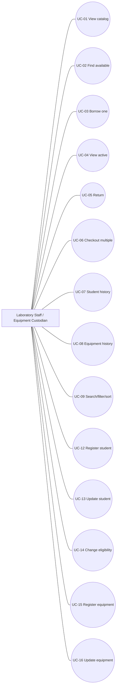

# Lab 4 use cases and verification map

Primary actor: Laboratory Staff / Equipment Custodian. The user selects existing students and physical equipment records. UC-10, UC-11, and UC-17 onward are deferred as stated by the supplied activity.

## Required suite summary

| ID / goal | Actor interaction and main branch | Rules and acceptance outcome |
|---|---|---|
| UC-01 View Equipment Catalog | Open Equipment; display identified items and availability. | BR-05–07; all equipment is visible with its status. Empty catalog is explained. |
| UC-02 Find Available Equipment | Turn on the available-only filter or inspect availability. | BR-10; only currently borrowable items appear in the filtered list. |
| UC-03 Borrow Equipment | Choose one student, one item, due date; confirm. | BR-08–11, 15–16; eligible student and available item become one active record; invalid/stale data is rejected. |
| UC-04 View Active Borrowings | Open active list. | BR-14, 17, 19; active records show student, item and dates; empty state is clear. |
| UC-05 Return Equipment | Select active record and return it. | BR-13–16; retain history, record local return date, make item available; reject repeat return. |
| UC-06 Check Out Multiple Equipment Items | Select student, at least two distinct item IDs and one future due date. | BR-08–12, 15–16; all items issue together or none; stale item, limit, eligibility, duplicate or persistence failure rejects the request. |
| UC-07 View Student Borrowing History | Enter a student ID and load history. | BR-14, 19; active and returned rows remain linked and visible after edits/returns. |
| UC-08 View Equipment Borrowing History | Enter an equipment ID and load history. | BR-10, 14, 19; the item's complete active/returned history is shown. |
| UC-09 Search, Filter, and Sort Borrowings | Search by name/number/item; choose status, date sort and direction. | BR-17, 19; controls combine, order is stable by borrowing ID, and no matches have an explicit message. |
| UC-12 Register Student | Enter number, name and optional contact. | BR-01–02; trimmed unique number, valid required fields, new student eligible. |
| UC-13 Update Student Information | Locate student and edit number/name/contact. | BR-01–03; stable identity and all history remain; blank optional contact clears. |
| UC-14 Change Student Borrowing Eligibility | Permit/restrict existing student. | BR-04; restriction blocks new loans but does not cancel current loans or block return. Repeating choice is harmless. |
| UC-15 Register Equipment | Enter unique equipment number, name and optional description/type. | BR-05–06; new equipment starts available and has no loan. |
| UC-16 Update Equipment Information | Locate item and edit number/name/description. | BR-05–07; stable item/history preserved; availability and dates are not edited here. |

## Traceability and current evidence

| Use cases | Implementation location | Verification evidence |
|---|---|---|
| UC-01–02 | `EquipmentViewModel`, `EquipmentView` | Build check; manual catalog/available-filter demonstration still required. |
| UC-03, UC-06 | `BorrowEquipmentService`, `EfBorrowingRepository.CheckoutAtomicallyAsync`, `EquipmentView` | Transaction revalidates student, limit, item rows and active loan; clean-database/manual success and forced-failure evidence still required. |
| UC-04–05 | `BorrowingsViewModel`, `ReturnEquipmentService`, `EfBorrowingRepository.ReturnAtomicallyAsync` | Build check; PostgreSQL return/restart demonstration still required. |
| UC-07–09 | `EfBorrowingRepository.GetHistoryAsync` / `SearchAsync`, `BorrowingsViewModel`, `BorrowingsView` | Build check; manual filters/sort/empty-state evidence still required. |
| UC-12–14 | `StudentManagementService`, `StudentManagementViewModel` | Existing validation and update flows; manual integrity/history evidence still required. |
| UC-15–16 | `EquipmentManagementService`, `EquipmentManagementViewModel` | Existing validation and update flows; manual integrity/history evidence still required. |

## Verification record

Expected: a .NET build succeeds with no errors. Observed: `dotnet build EquipmentBorrowing.slnx --no-restore -m:1 -p:UseSharedCompilation=false -v minimal` succeeded with 0 warnings and 0 errors. `git diff --check` reported no whitespace errors. PostgreSQL could not be reached at localhost from this environment, so migration-on-clean-database, restart persistence, database constraint behavior, rollback injection and recovery were not observed here. Do not treat the build as database-operation evidence. Update this record with observed results/screenshots during the demonstration.

BR-18 recovery: if a transaction commit response is lost, the application reports an unknown outcome, does not retry automatically, and instructs staff to refresh records before choosing another action. A known pre-commit failure rolls back the transaction. No claim of successful rollback testing is made until the disposable database failure demonstration is recorded.
